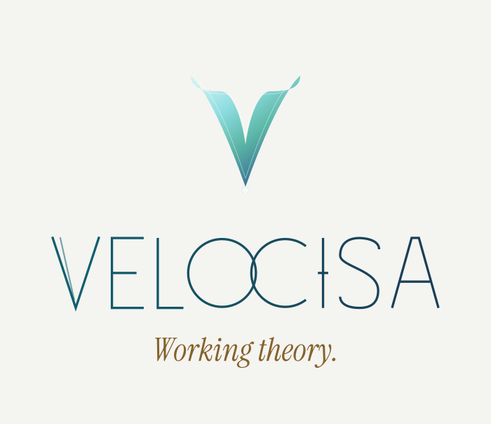

  <picture>
    <source media="(prefers-color-scheme: dark)" srcset="./velocisa-lockup-stacked-brandline-on-dark.svg">
    
  </picture>

Software that takes care of you while you do the work that matters.

Velocisa Labs is a small software company, founded in India in 2025. We make a few things, carefully, and keep improving them.

### What we've built

**NightRise**, a shift work calendar for Android, for people whose week doesn't start on Monday. Closed test from 4 Dec 2026.

### What we believe

Six things we believe, until we know better. [Read the manifesto](https://velocisa.com/manifesto).

[velocisa.com](https://velocisa.com) · [support@velocisa.com](mailto:support@velocisa.com)
